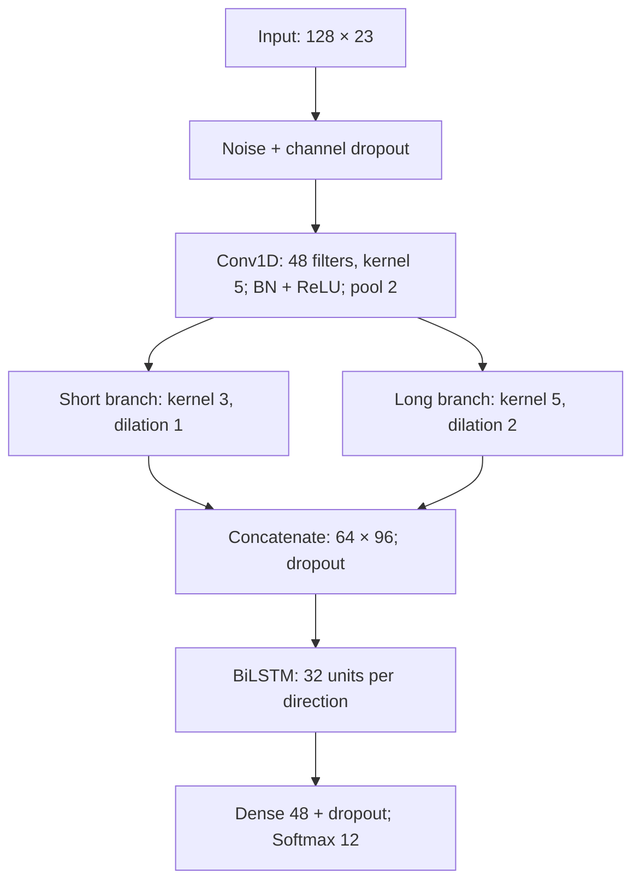
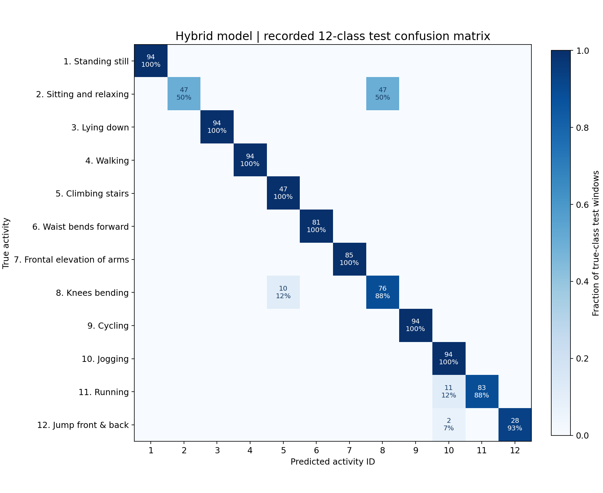
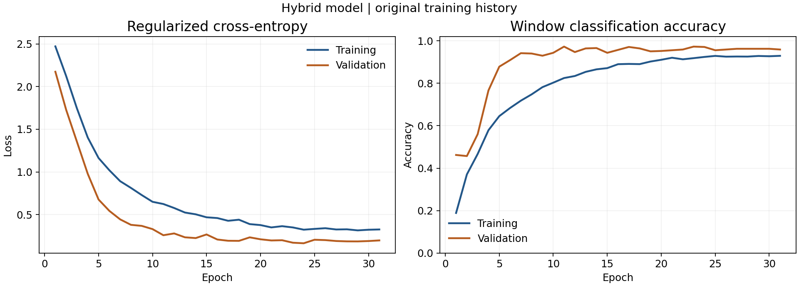

# mHealth Human Activity Recognition

### Multi-scale temporal CNN + bidirectional LSTM

Classifying **12 physical activities** from wearable sensor windows with TensorFlow/Keras. This project combines parallel temporal convolutions with a BiLSTM and examines how model architecture, activity-run separation, and checkpoint selection affect the interpretation of an experiment.

The recorded hybrid model achieves **92.91% test accuracy** and **92.80% Macro-F1** on 987 windows. Saved-checkpoint inference reproduced all five archived experiments during the repository conversion; full training from initialization has **not** been repeated. The evaluation separates contiguous activity runs, and **does not establish generalization to unseen subjects**.

[Methodology](#methodology) · [Results](#experimental-results) · [Reproduce](#installation-and-reproduction) · [Scientific audit](docs/SCIENTIFIC_AUDIT.md) · [Validation](docs/VALIDATION.md)

## Technical focus

- Boundary-preserving window construction: 128 timesteps × 23 channels, stride 64.
- Per-activity assignment of complete label runs before window generation.
- StandardScaler fitted exclusively on training rows; training-derived balanced weights are saved.
- Two temporal CNN branches with different kernel sizes/dilation rates, followed by bidirectional recurrence.
- CNN, LSTM, and BiLSTM reference experiments, with their original training settings preserved.
- Traceable evidence: original notebook, untouched metric CSVs, input/artifact hashes, checkpoint checks, and explicit limitations.
- Portable CLI, JSON experiment configs, synthetic-data tests, and lightweight GitHub Actions checks.

The refactor adds packaging and validation. It introduces no new benchmark result or architectural improvement.

## Technologies

Python, NumPy, pandas, scikit-learn, TensorFlow/Keras, Matplotlib, Jupyter, pytest, Ruff, and GitHub Actions. Runtime configuration uses JSON and Python's standard library.

## Dataset

This experiment uses the **provided Kaggle `mHealth.csv` derivative** of the [UCI MHEALTH dataset](https://archive.ics.uci.edu/dataset/319/mhealth+dataset), via [Pratyay Dhar's Kaggle dataset](https://www.kaggle.com/datasets/pratyaydhar/mhealth).

| Property | Supplied CSV |
| --- | --- |
| Rows | 308,021 |
| Sensor columns | 23 numerical columns, `A` through `W` |
| Target | `activity`, original IDs 1–12 |
| Missing values / duplicate rows | 0 / 0 |
| Contiguous label runs | 105 |
| Subject/session columns | Unavailable |
| Smallest class | Jump front & back: 9,267 rows |

UCI describes recordings from 10 volunteers, with chest, ankle, and wrist sensors at 50 Hz. Those are **source-dataset facts**, not verified subject metadata for this CSV. If sampling rate and continuity are preserved, a 128-sample window represents 2.56 seconds. The conversion from the original subject logs to this smaller CSV is not supplied; the full UCI release is **not an interchangeable input** for reproducing these numbers. The exact A–W channel-to-sensor mapping has not been independently verified.

The UCI source is licensed **CC BY 4.0**. Kaggle derivative metadata/license could not be retrieved during this audit; verify its current terms before redistribution. This repository includes no raw dataset, processed sensor arrays, or trained weights. Original notebook outputs retain a small sensor preview for provenance. See [data provenance and access](docs/DATA.md) for hashes, activity IDs, attribution, and acquisition details.

## Methodology

1. Validate numeric sensor columns and original activity IDs without changing CSV row order.
2. Identify contiguous equal-label runs. Shuffle runs separately within each activity using seed 43.
3. Assign complete runs to train/validation/test using target run ratios 70/15/15 and the original rounding rule.
4. Fit standardization on training rows only, then window each scaled run independently.
5. Train with experiment-specific class weights and regularization.
6. Evaluate a fixed model state using accuracy, macro precision/recall/F1, Weighted-F1, and confusion counts.

| Split | Label runs | Raw rows | Windows | Window share |
| --- | ---: | ---: | ---: | ---: |
| Train | 70 | 205,108 | 3,127 | 66.59% |
| Validation | 12 | 38,092 | 582 | 12.39% |
| Test | 23 | 64,821 | 987 | 21.02% |

The nominal ratios apply to **run counts per activity**, not exact row/window fractions. A label run can merge separate recordings if adjacent boundaries have the same label; it is a proxy for temporal continuity, not a verified session. Overlap occurs within a split, making neighboring test windows correlated.

### Hybrid architecture



Convolutions extract local temporal patterns at complementary receptive fields. The BiLSTM integrates the resulting sequence in both directions within an already collected window; it is not a causal streaming model. The hybrid has **61,404 parameters**, including 288 non-trainable batch-normalization parameters.

Training uses AdamW, sparse categorical cross-entropy, batch size 32, a 35-epoch maximum, learning rate 2.5e-4, weight decay 1e-4, and L2 coefficient 1.5e-4. The hybrid's recurrent dropout is **0.0**, despite a stale Markdown statement in the original notebook. Its manual class weights are 1.0 for classes 1–11 and 1.6 for class 12; the balanced weights exported by preprocessing are **not** used by this experiment.

## Experimental results

These are **recorded single-run results**, independently checked against the original confusion counts and saved-checkpoint inference. All four rows below use the original 12-class test arrays. They are reference comparisons, not a controlled ablation: training settings and selection rules differ.

| Model | Parameters | Test accuracy | Macro precision | Macro recall | Macro-F1 | Weighted-F1 |
| --- | ---: | ---: | ---: | ---: | ---: | ---: |
| Multi-scale CNN + BiLSTM | 61,404 | **92.91%** | 94.34% | 93.33% | **92.80%** | **92.68%** |
| Multi-scale CNN | 29,916 | 89.87% | 93.74% | 90.36% | 90.02% | 89.33% |
| Stacked BiLSTM | 89,132 | 87.23% | 89.83% | 87.94% | 86.85% | 86.66% |
| Stacked LSTM | 36,588 | 85.82% | 89.02% | 86.02% | 85.30% | 85.53% |

| Experiment detail | Hybrid / CNN | Stacked LSTM / BiLSTM |
| --- | --- | --- |
| Maximum epochs | 35 | 60 |
| Learning rate | 2.5e-4 | 2.0e-4 |
| Class weights | Manual, final class 1.6 | Balanced from training windows |
| Saved state | Hybrid: validation Macro-F1; CNN: final executed epoch | Validation Macro-F1 |
| Early stopping / learning-rate reduction | Validation loss | Validation loss |

The hybrid's accuracy is 3.04 percentage points above the CNN and 5.67 points above the BiLSTM when computed from the unrounded metrics. There are no repeated-seed confidence intervals or significance tests. Validation accuracy is 100% for the CNN but 89.87% on test, emphasizing the need to inspect the evaluation protocol rather than a favorable validation score alone.



The hybrid correctly classifies 917/987 test windows. Its 70 errors comprise sitting → knees bending (47), knees bending → climbing stairs (10), running → jogging (11), and jumping → jogging (2). These observed confusions do not establish their physical cause.



A separate **11-class CNN** removes activity 2 (sitting), yielding 93.06% accuracy on **893** test windows. This is a different task and is excluded from the main comparison. A further 11-class single-layer BiLSTM cell has no stored outputs; its configuration is retained without claiming a result. [Experiment lineage](docs/SCIENTIFIC_AUDIT.md#experiment-lineage) maps each variant to its source cell and artifacts.

## Installation and reproduction

Use **Python 3.12** (the locally validated version). Python 3.11 is included in the proposed CI matrix but was not run locally. Run commands from the repository root.

Clone this project after the repository is published:

```bash
git clone https://github.com/pratyaydr/mhealth-multiscale-cnn-bilstm.git
cd mhealth-multiscale-cnn-bilstm
python -m venv .venv
source .venv/bin/activate
python -m pip install --upgrade pip
python -m pip install -r requirements.txt
```

Windows PowerShell activation: `.venv\Scripts\Activate.ps1`. TensorFlow GPU installation differs by platform; consult [official installation instructions](https://www.tensorflow.org/install/pip). The pinned reference environment targets TensorFlow 2.20.0 and Keras 3.13.2, matching the Keras version embedded in the original checkpoints. The original notebook does not record a complete dependency lock. [Validated package snapshot](evidence/validation_environment.json) records the conversion environment rather than pretending to reconstruct the original one.

### Inspect evidence without training or downloading data

```bash
python -m pip install -e '.[dev]'
python -m mhealth_har audit
python -m pytest -q
python scripts/check_repository.py
python -m jupyter nbconvert --execute --to notebook --inplace notebooks/reproducible_walkthrough.ipynb
```

TensorFlow tests skip when the optional dependency is absent. The walkthrough executes entirely from included aggregate evidence, imports reusable modules, and does not rerun model training. Its saved outputs were generated by the documented in-process fallback because local Jupyter kernel sockets were unavailable; see [execution details](docs/VALIDATION.md#important-execution-distinctions).

### Rebuild the data and train

Download `mHealth.csv` from the linked Kaggle dataset and place it at `data/raw/mHealth.csv` without sorting, filtering, or shuffling its rows. Check its SHA-256 against [the input manifest](evidence/input_manifest.json). If the file is unavailable or differs, exact historical reproduction remains blocked; do not substitute the UCI logs silently.

```bash
python -m mhealth_har prepare --config configs/preprocessing.json
# Seed Python hashing at process startup; random/NumPy/TensorFlow seeds are also set.
PYTHONHASHSEED=43 python -m mhealth_har train --config configs/hybrid.json
python -m mhealth_har evaluate --run runs/hybrid --split test
```

In PowerShell set `$env:PYTHONHASHSEED='43'` before the training command. `prepare` also accepts `--data /path/to/mHealth.csv --output /path/to/processed`. Training reads only train/validation arrays; the evaluation command explicitly opens the requested split. Use a new `--output` directory for another run: existing outputs are protected from overwriting.

Reference experiments use `configs/cnn.json`, `configs/lstm.json`, and `configs/bilstm.json`. Legacy alternatives use `configs/cnn11.json` and `configs/bilstm11.json`. Each configuration preserves its original class weights, training budget, and selection behavior. Store any corrected common-protocol comparison in a separate run and report it as a new experiment.

Each training run saves configuration, package versions, class weights, parameter count, training history, selection metadata, and `model.keras`. Evaluation saves metrics, a per-class report, raw/normalized confusion matrices, and predictions. Generated arrays, weights, and run directories are ignored by Git.

### Validate your supplied artifact archive

If you retained the original `results.zip`, validate preprocessing and optionally all five checkpoints without adding the ZIP to the repository:

```bash
python scripts/validate_artifacts.py --csv /path/to/mHealth.csv --results /path/to/results.zip
python scripts/validate_artifacts.py --csv /path/to/mHealth.csv --results /path/to/results.zip --checkpoints
python scripts/make_figures.py
```

Only load model artifacts you trust. The validator uses named ZIP entries and temporary files. Original run assignments and labels matched exactly; rebuilt standardized arrays matched with maximum absolute difference 1.91e-6. Full retraining, GPU parity, and numerical identity across platforms remain unverified.

## Project structure

| Path | Purpose |
| --- | --- |
| `src/mhealth_har/` | Validated data preparation, architectures, training, evaluation, evidence audit, and figures |
| `configs/` | Preprocessing plus six original experiment variants |
| `notebooks/original_experiment.ipynb` | Byte-preserved Kaggle notebook, including outputs and historical inconsistencies |
| `notebooks/reproducible_walkthrough.ipynb` | Executed guide to modules and original evidence |
| `evidence/original/` | Unmodified aggregate CSV/JSON files copied from the supplied archive |
| `evidence/*validation*.json` | Results of checks actually executed during conversion |
| `assets/figures/` | Figures redrawn from original confusion counts and training history |
| `tests/` | Synthetic boundary/scaler tests, metric reconciliation, architecture and training-step checks |
| `docs/` | Audit, data access, validation, conversion report, and publication guide |
| `.github/workflows/ci.yml` | Core checks plus a TensorFlow smoke job; remote execution pending |

## Limitations and future work

- **Subject independence:** unavailable IDs prevent leave-one-subject-out validation. Future work should begin with original subject logs and preserve session boundaries; this changes the experiment and its results.
- **Label-dependent segmentation:** windows are built using known activity boundaries. Real-world inference will encounter transitions and cannot rely on oracle labels for segmentation.
- **Correlated windows and small validation partition:** only 12 validation label runs are available, with overlapping windows. Window counts overstate the number of independent observations.
- **Historical comparisons:** checkpoint rules, weights, regularization, and epoch budgets vary. Align these and repeat across seeds before attributing gains to architecture alone.
- **Provenance and compute:** original CSV construction and complete Kaggle package versions are unavailable. Training from initialization and latency/energy measurements have not been reproduced.
- **Development history:** code avoids test-driven checkpoint selection, but the artifacts cannot prove the test set was never consulted during prior development.

Proposed work includes subject-aware validation, fixed-protocol ablations, repeated seeds, window-length sensitivity, sensor corruption tests, and deployment benchmarking. These are proposals, not implemented results. This project is an activity classifier and makes no clinical-performance claim.

## Original Kaggle notebook

[View the original experiment on Kaggle](https://www.kaggle.com/code/pratyaydhar/notebook2d06429765).

The uploaded notebook is preserved locally as the source of truth; the live Kaggle page was inaccessible during conversion. This version extracts reusable code, replaces machine-specific paths, preserves the experiment settings, and records inconsistencies instead of silently rewriting historical evidence. The accompanying internship report was reviewed as secondary context; its binary is omitted from the publication bundle because it is not needed to execute or audit the experiment.

## Author and licensing

**Pratyay Dhar** — third-year undergraduate in Computer Science and Engineering at NIT Silchar, with interests in machine learning, deep learning, and AI for healthcare. [GitHub](https://github.com/pratyaydr) · [Kaggle](https://www.kaggle.com/pratyaydhar).

LinkedIn is intentionally not listed because no verified public profile URL was provided. See [author metadata](configs/author.json).

No software LICENSE has been assigned because a license choice was not provided. Public visibility alone does not grant reuse rights. Choose an appropriate license for your own code before inviting reuse; dataset terms and third-party attribution remain separate. See [third-party notices](THIRD_PARTY_NOTICES.md).
